# Picture-block experiment

Open [the experiment](https://pesojka.github.io/interomap/experiment.html).
The task starts with informed consent, participant setup, one practice body map,
and a baseline body map. A brief instruction screen then explains how to map the
bodily feelings evoked by the pictures. It stays visible until the participant
selects “Pokračovat”; after the usual 1-second blank, the 16 picture/body-map
trials begin, followed by ratings of the same 16 pictures.

The Czech consent text in `experiment.html` is provisional and contains explicit
placeholders for the research team/contact, study duration and data-handling
information. Replace those placeholders and update `CONSENT.version` when the
text is finalized. The consent checkbox starts unchecked; participants cannot
continue until they check it. Consent acceptance, text version, provisional status
and timestamp are saved with the completed submission.

Practice is self-paced and uses a separate empty map before the baseline. Its
drawings are discarded; only completion and duration are recorded. All maps use
the existing medium brush size (32 in native image coordinates), with alternate
sizes removed. All three rating scales, including personal relevance, display
9 on the left and 1 on the right; stored answers retain their displayed values.

| Block ID | Condition | IAPS image IDs |
| --- | --- | --- |
| `threat` | Threat | 1300, 1525, 2811, 6510 |
| `integrity_disruption` | Integrity disruption | 3030, 3213, 3261, 9042 |
| `positive_1` | Positive | 1463, 1710, 1920, 2071 |
| `positive_2` | Positive | 2347, 5628, 7325, 8540 |

Each new participant session independently shuffles the four blocks and the four
images inside each block using Fisher–Yates. All four images in a block remain
consecutive; each image appears exactly once in the mapping section and once in
the rating section. The two positive blocks retain the membership shown above.
The rating section reuses the mapping order without reshuffling. All 24 block
orders are possible; random assignment does not guarantee equal counts of each
order across the sample. Resuming after refresh preserves the assigned order.

Practice and baseline both remain outside the randomized picture blocks. Existing timing remains:
6 seconds per loaded picture, 1-second blanks around mapping, self-paced maps and
ratings, and 5-second preparation intervals between rated pictures. A failed
picture load offers a retry and cannot silently skip that picture.

JSON schema version 6 records `randomization.blockOrder` and includes `block`,
`condition`, `blockPosition` (1–4), and `positionWithinBlock` (1–4) on each picture
map and rating. `position` is the actual presentation position (1–16); `variable`
and `image` identify the stimulus independently of its position. Both positive
blocks have condition `positive`. Baseline block fields are null. CSV exports
include `block`, `condition`, `block_position`, and `position_within_block`, plus
`consent_accepted`, `consent_version`, `consent_accepted_at`, and `practice_completed`.
JSON also includes `consent`, `practice` (no drawings), and `bodyMapBrush` metadata.
Pending completed submissions from older versions retain their original data on retry.

Stimulus definitions and randomization are in `experiment.html`; the selected
images are under `stimuli/<block ID>/`. Run the dependency-free regression tests:

```sh
node --test tests/experiment-blocks.test.mjs collector/*.test.mjs
```

The tests cover all 24 block permutations, all 24 within-block permutations,
1,000 simulated sessions, and the full consent → practice → baseline → 16 maps →
16 ratings sequence, including consent gating, practice exclusion, load/retry
timing, descending rating values and JSON/CSV metadata.

This repository contains the distributed Svelte build. The active brush control
is in `_app/immutable/entry/_page.svelte.3c0d6b5c.js`; its medium default, available
options and size-change handler are fixed. Cache versions in `index.html`, the
app entry and route chunk are updated together when changing this bundle.

## Autosave and refresh recovery

After consent and participant setup, the experiment saves completed steps in the
current tab's `sessionStorage` and sends checkpoints to the CERIT collector.
Checkpoints are made after practice, baseline, each picture map ("Hotovo"), each
picture rating ("Další"), and section starts. Practice drawings remain excluded.
The latest completed checkpoint is retried after a connection failure and when
the browser comes online. Autosave does not block the next trial. Saving feedback
appears on instruction screens, away from timed pictures and blank intervals.

Refreshing in the same browser tab offers to resume with the same participant,
figure, completed responses, and randomized order. The interrupted step restarts
from the beginning, including its picture exposure; unfinished strokes/ratings
are not restored. Every accepted resume is logged in `dataset.resumes` with its
time and step/index so repeated exposures can be considered during analysis.
Choosing a new participation requires fresh consent and leaves the previous
server draft classified as incomplete.

Browser recovery depends on session storage being available. Closing the tab,
clearing browser data, or changing devices does not provide a resume mechanism.
Server-acknowledged checkpoints survive tab closure, but an offline checkpoint
that has not reached the server may be lost when the tab closes. The session is
retained locally until the final result has a matching server receipt. This
feature complements infrastructure backups; it does not replace them.

Schema version 6 adds `status` (`in_progress` or `complete`), `progress` counts,
`resumes`, `nextStep` on checkpoints, and `completed` on individual maps. An empty
completed map has `completed: true, responded: false`; an unvisited map has
`completed: false`. CSV adds `session_status`, `map_completed`, and `resume_count`.
Incomplete datasets contain all planned trials, with unvisited trials marked as
such; use the completion fields instead of treating these as empty responses.

Collector details, storage locations, and API contract are in
[collector/AUTOSAVE.md](collector/AUTOSAVE.md).

# Getting started

## Associated publication
Please cite:
Desmedt, O., Maurage, P., Leganes-Fonteneau, M., Billaux, P., & Billieux, J. (2025).
InteroMap: A Novel Tool to Map the Phenomenology of Bodily Sensations.

## Qualtrics

The following instructions will show you how to embed the InteroMap tool in a
Qualtrics survey. You need to repeat these steps for every question in which 
you wish to use InteroMap.

Here is an overview of the procedure:

1. Create a block containing the InteroMap tool preloaded with the _Female_ 
   persona.
2. Create another block with the InteroMap tool preloaded with the _Male_ 
   persona.
3. Create a question inviting the user to choose a persona.
4. Program your survey to receive data from the InteroMap tool and save it in 
   Qualtrics.

Note: If you use InteroMap multiple times in your survey (e.g. for different 
questions), you must choose a unique variable name which will hold the 
InteroMap data for each question separately. In the steps below, we use the 
variable `question1data` as an example to hold the data of the first question. 
If we have another question, say question 4, which uses InteroMap too, we must 
use another variable that we could name `question4data` for example.

### Steps

1. Click on one of the first questions of your survey (e.g., the welcome page). On the left, at 
the bottom of the _Edit question_ panel, click on **JavaScript**. Please don't insert this code
in a question/block that redirects participants to one or other branch. 

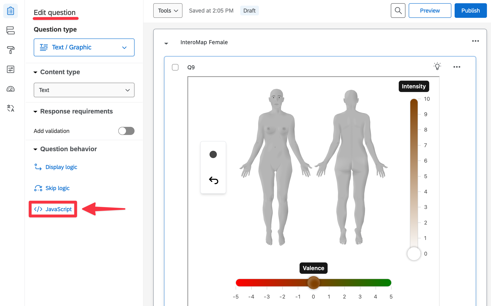

2. A new popup named _Edit Question JavaScript_ appears. Copy the following 
code inside the text area.

```javascript
Qualtrics.SurveyEngine.addOnReady(function()
{
 window.addEventListener('message', function(event) {
  if (event.data.event === "interomap_data") {
   Qualtrics.SurveyEngine.setEmbeddedData(event.data.variable, event.data.output);
  }
 })
});
```

Click on **Save**.

3. Add a new block to your survey by clicking on **Add Block** and to name it 
_InteroMap Female_.

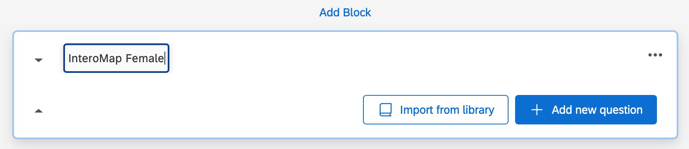

4. Inside this block, click on **Add new question** and select 
**Text / Graphic**

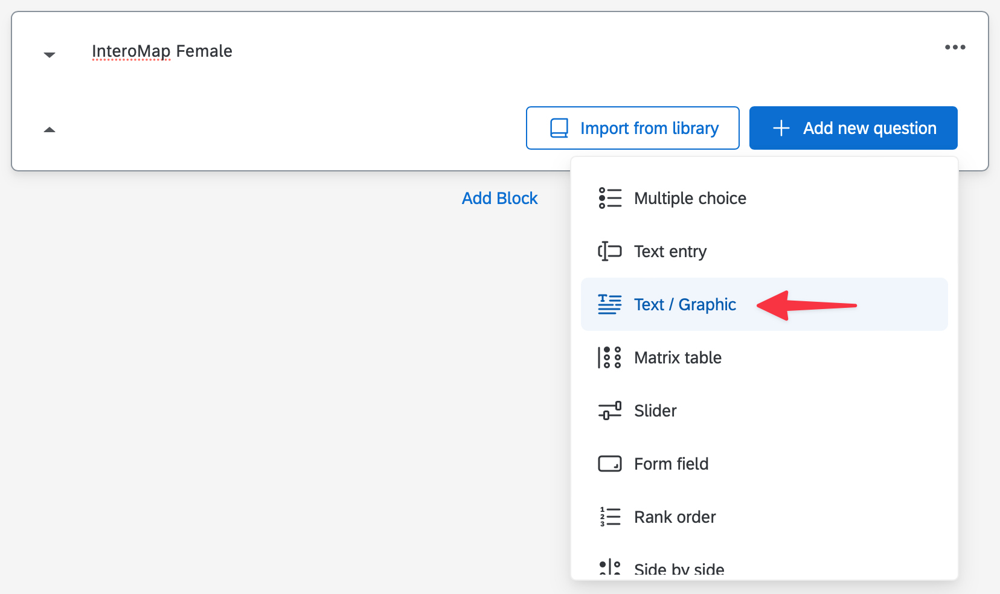

5. A new question will appear inside the block. When you hover it, its 
background becomes gray. Click on it to enable the question toolbar.

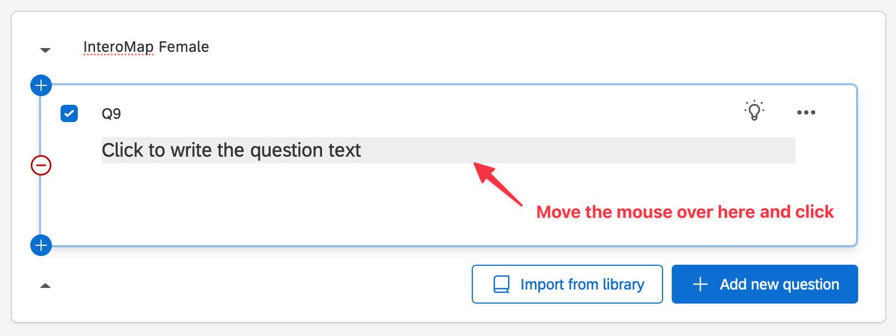

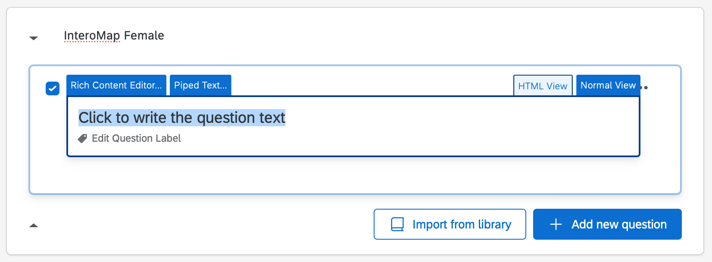

6. Click on the **HTML View** tab. You should now be able to insert HTML code.

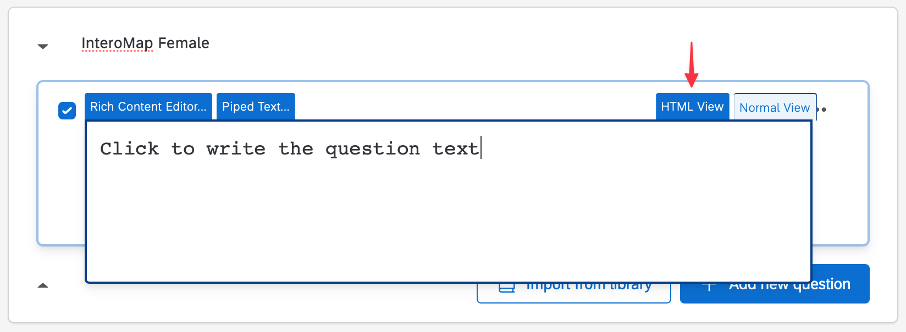

7. Insert the following HTML code to embed the InteroMap tool with the 
pre-selected _female_ persona. Replace `<YOUR_VARIABLE>` in the code to
a variable name of your choosing. Use only alphanumeric ASCII characters
and always start with a letter. Do not use diacritics.

Examples of valid variable names: `control`, `happy`, `emotion1`,...

Replace `lang=en` with `lang=fr` if you wish to show the tool in French.
Only English and French are available currently.

```html
<iframe id="interomap_tool" src="https://interomap.github.io/interomap-dist/?lang=en&persona=female&variable=<YOUR_VARIABLE>" style="width: 100%; height: 100vh;" title="InteroMap Tool - Female"></iframe>
```

8. Click outside the text area to select the question panel. The InteroMap tool should now appear inside the question.

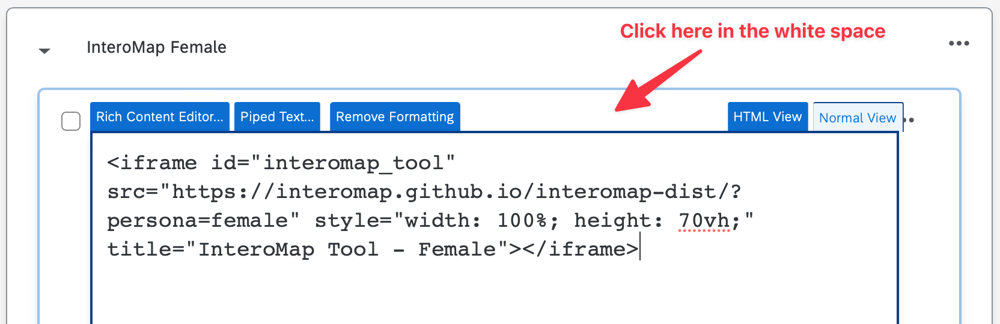


9. Repeat the steps 3 to 8 for another block named _InteroMap Male_. At step 7, 
replace `persona=female` with `persona=male` in the code.

10. To create the question inviting the user to choose a persona, create a new 
block and a new question inside it. Move this new block _before_ the ones 
containing the InteroMap tool. Design it to your liking. Here is an example :

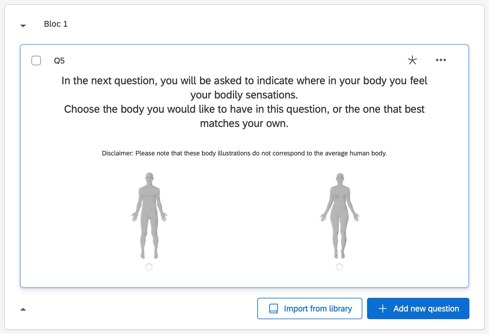

11. Open the block menu in the upper right corner and select 
**View block in survey flow**

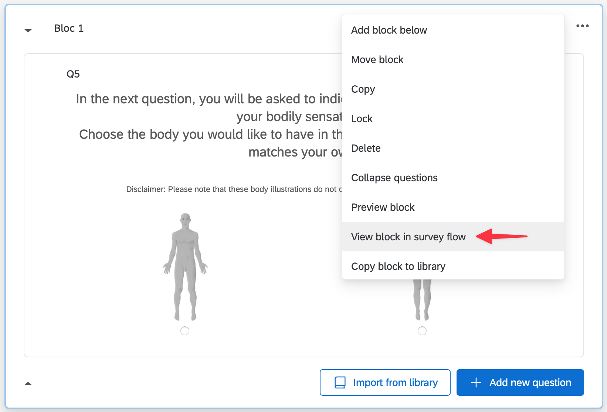

12. Create the following flow.

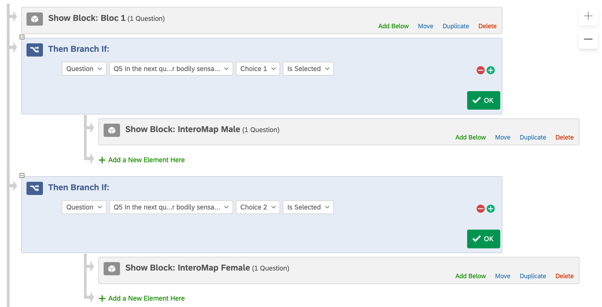

13. While you're in the _Survey flow_ page, at the bottom of the flow, click on 
**Add a New Element Here**. A new panel appears, click on **Embedded Data**.

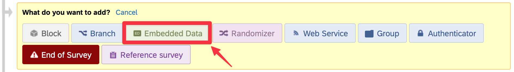

14. Click on **Create New Field or Choose From Dropdown...** and type 
the variable name you chose at step 5 above. **Important**: the variable name
MUST be transcribed EXACTLY as in the code at step 7 (beware of the letter case).
Click on **Apply** to save your changes.

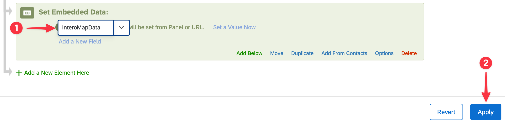

Repeat this step as many times as you have questions using InteroMap. For example, 
if you are using InteroMap in 3 questions, you should create 3 distinct variables.

15. To have a good format, we advise you to change the "style" of your Qualtrics.
Here are the steps: (1) Go to “Look and feel”; (2) Click on “Style”; (3) In custom CSS,
copy the following code:

```css
.SkinInner{
width: 100% !important;
}
``` 
16. To make sure that participants understand the task, we use detailed instructions
by illustrating the different steps that they should follow. We also use a control
task that requests them to color specific regions with specific colors.

:tada: You are done embedding the InteroMap tool in your survey.

**Questions?**
Please contact olivier.desmedt@uclouvain.be.

**How to visualize and analyze data?**
Another webpage exists to visualize individual and aggregated maps:
https://interomap.github.io/processing-tool/. The instruction page is available 
here: https://github.com/interomap/processing-tool.

**Important notes:**
NB1: Note that old versions of some web browsers may be incompatible with the
tool, although it is rare. 
NB2: Please pretest the tool and visualize the data before launching your experiment.
NB3: Because of Qualtrics limitations, there is a maximum drawing size. Although this
limit is difficult to reach and therefore rarely occurs, participants who make many 
drawings may eventually reach it, particularly if they draw outside the body area 
(these drawings are not visible but are still stored). If this occurs, ask 
participants to avoid drawing outside the body.
